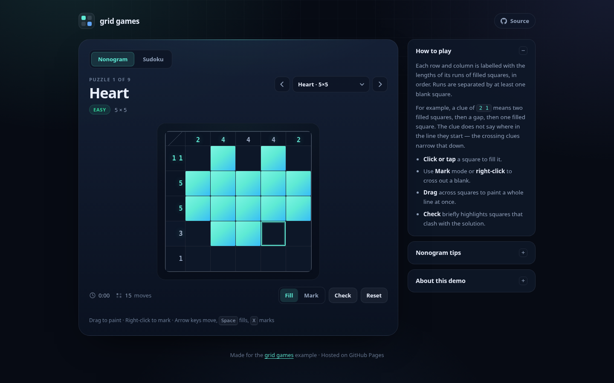
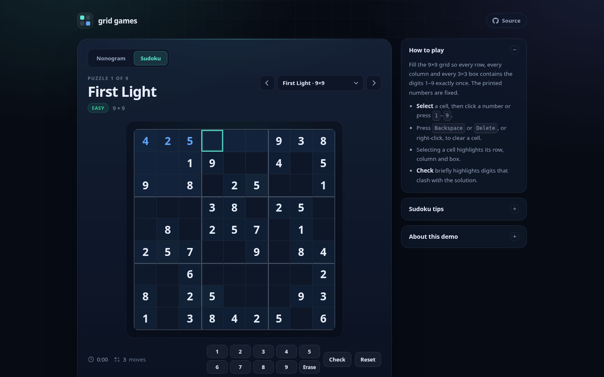

# grid games

A small, dependency-free collection of grid puzzles that runs as a static site on GitHub Pages:

**▶ [Play the games](https://potnoodledev.github.io/nonogram/)**



The site has two modes that share one game shell:

- **Nonogram** — use the number clues to fill squares and reveal a picture.
- **Sudoku** — fill a 9×9 grid so every row, column and 3×3 box contains the digits 1–9 exactly once.

Both modes use the same board rendering, timer, move counter, progress persistence, Check helper and win dialog. The rules and presentation for each mode live in a small adapter under `js/modes/`, so another grid variation can reuse the shell without touching the nonogram or Sudoku code.

## Features

- Nine nonogram puzzles from 5×5 to 15×15 and nine Sudoku puzzles, grouped into Easy, Medium and Hard.
- Nonogram clues are derived from the art at load time; Sudoku solutions are derived from the givens. Puzzle data cannot drift from its solution.
- Mouse, touch and keyboard input — drag to paint nonogram squares, right-click to mark or erase, and type Sudoku digits straight into the grid.
- Completed nonogram rows and columns light up; Sudoku highlights the selected row, column and box and flags duplicate digits. An optional **Check** highlights conflicts with the solution.
- Progress, timer and move count are saved in `localStorage` per mode, so a reload does not lose your place.
- No build step, no dependencies and no tracking.



## Run locally

```sh
npm run serve
# or: python3 -m http.server 4173
```

Then open <http://127.0.0.1:4173/>.

## Tests

```sh
npm test
```

This runs the Node suite for the nonogram clue calculation and the Sudoku rules. It validates that every nonogram's derived clues match its art and that every Sudoku has exactly one solution.

The browser smoke test (both modes, layout, input, solving, persistence) needs Playwright and a running local server:

```sh
npm i -D playwright
npx playwright install chromium
npm run serve          # in another terminal
npm run test:e2e
```

Set `BASE_URL` to point the browser test at another server, for example `BASE_URL=https://potnoodledev.github.io/nonogram/ npm run test:e2e`. Set `PLAYWRIGHT_CHROMIUM` to use a specific Chromium binary.

## Project layout

```text
index.html            page shell and the per-mode help panels
css/styles.css        all styling, including the responsive board sizing
js/grid.js            tiny shared helpers (grids, time formatting)
js/game.js            shared game shell: board, input, timer, persistence, dialogs
js/modes/nonogram.js  nonogram rules adapter and clue rendering
js/modes/sudoku.js    sudoku rules adapter, digit pad and highlighting
js/nonogram.js        pure nonogram rules: clues, completion, mistakes, win check
js/sudoku.js          pure sudoku rules: parsing, conflicts, solving, win check
js/puzzles.js         nonogram art; clues are derived from the art at load time
js/sudoku-puzzles.js  sudoku givens; solutions are derived from the givens at load time
js/app.js             boots the shared shell with both modes
tests/                Node unit tests and the Playwright smoke test
docs/evidence/        screenshots used in the pull request and this README
```

## Adding a nonogram

Add an entry to `PUZZLE_ART` in `js/puzzles.js` with an `id`, `name`, `difficulty` and rows of `#` (filled) and `.` (blank). The clues are computed from the art, and the puzzle automatically appears in the picker. Keep every row the same width; the unit tests check this and verify the generated clues.

## Adding a Sudoku

Add an entry to `SUDOKU_DEFINITIONS` in `js/sudoku-puzzles.js` with an `id`, `name`, `difficulty` and 81-character `givens` string (`1`–`9` for givens, `.` for blanks). The solution is computed from the givens at load time, and the unit tests verify that the puzzle has exactly one solution.

## Adding another mode

Create an adapter in `js/modes/` that provides the puzzle catalogue, board layout, cell rendering, input hooks and a toolbar. Register it in `js/app.js`; the shell handles the board DOM, focus navigation, timer, moves, persistence, checking and the win dialog. The interface is documented in [`js/modes/README.md`](js/modes/README.md), and `js/modes/nonogram.js` and `js/modes/sudoku.js` are complete examples.

## Deployment

GitHub Pages publishes the `main` branch root at <https://potnoodledev.github.io/nonogram/>. Pushing to `main` rebuilds the site; `.nojekyll` makes Pages serve the files as-is. The repository is public because GitHub Pages on the current plan requires a public repository.
