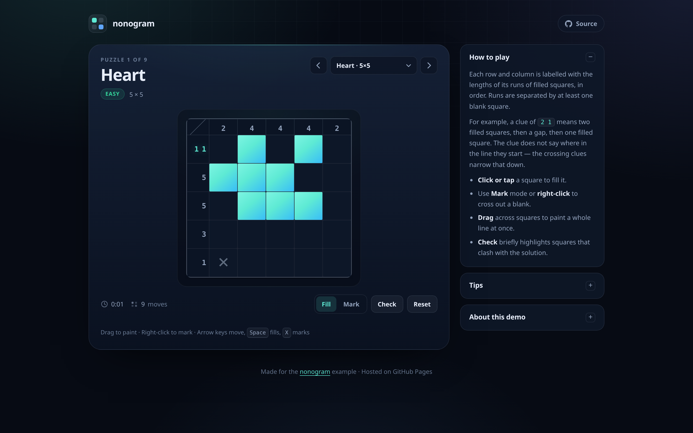

# nonogram

A nonogram (also known as a picross or griddler) is a logic puzzle played on a grid, where the goal is to fill in cells to reveal a hidden picture. Each row and column is labelled with the lengths of its runs of consecutive filled cells, in order, which must be separated by at least one empty cell. Solvers use those clues to deduce which cells are filled and which are empty, without guessing.

This repository holds a small, dependency-free nonogram game that runs as a static site on GitHub Pages:

**▶ [Play the game](https://potnoodledev.github.io/nonogram/)**



## Features

- Nine hand-drawn puzzles from 5×5 to 15×15, grouped into Easy, Medium and Hard.
- Mouse, touch and keyboard input — drag to paint, right-click to mark, arrow keys to move.
- Completed rows and columns light up, with an optional **Check** for mistakes.
- Progress, timer and move count are saved in `localStorage`, so a reload does not lose your place.
- No build step, no dependencies and no tracking.

## Run locally

```sh
npm run serve
# or: python3 -m http.server 4173
```

Then open <http://127.0.0.1:4173/>.

## Tests

```sh
npm test
```

This runs the Node test suite for the clue calculation and validates that every puzzle's derived clues match its art.

The browser smoke test (layout, input, solving, persistence) needs Playwright and a running local server:

```sh
npm i -D playwright
npx playwright install chromium
npm run serve          # in another terminal
npm run test:e2e
```

Set `BASE_URL` to point the browser test at another server, for example `BASE_URL=https://potnoodledev.github.io/nonogram/ npm run test:e2e`. Set `PLAYWRIGHT_CHROMIUM` to use a specific Chromium binary.

## Project layout

```text
index.html          page shell
css/styles.css      all styling, including the responsive board sizing
js/nonogram.js      pure puzzle logic: clues, line completion, mistakes, win check
js/puzzles.js       puzzle art; clues are derived from the art at load time
js/app.js           game state, rendering, input and persistence
tests/              Node unit tests and the Playwright smoke test
docs/evidence/      screenshots used in the pull request and this README
```

## Adding a puzzle

Add an entry to `PUZZLE_ART` in `js/puzzles.js` with an `id`, `name`, `difficulty` and rows of `#` (filled) and `.` (blank). The clues are computed from the art, and the puzzle automatically appears in the picker. Keep every row the same width; the unit tests check this and verify the generated clues.

## Deployment

GitHub Pages publishes the `main` branch root at <https://potnoodledev.github.io/nonogram/>. Pushing to `main` rebuilds the site; `.nojekyll` makes Pages serve the files as-is. The repository is public because GitHub Pages on the current plan requires a public repository.
