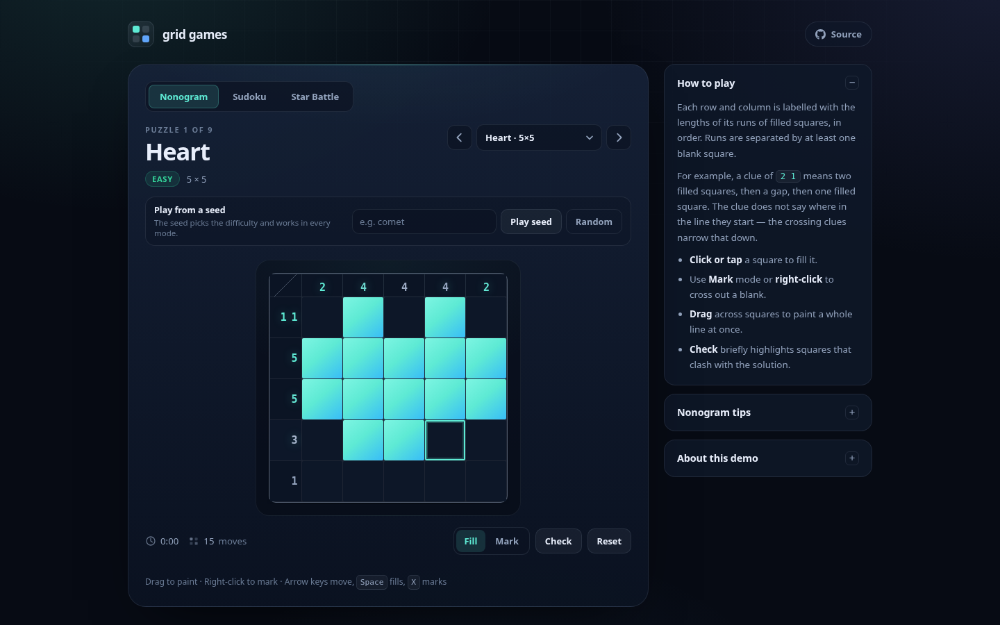
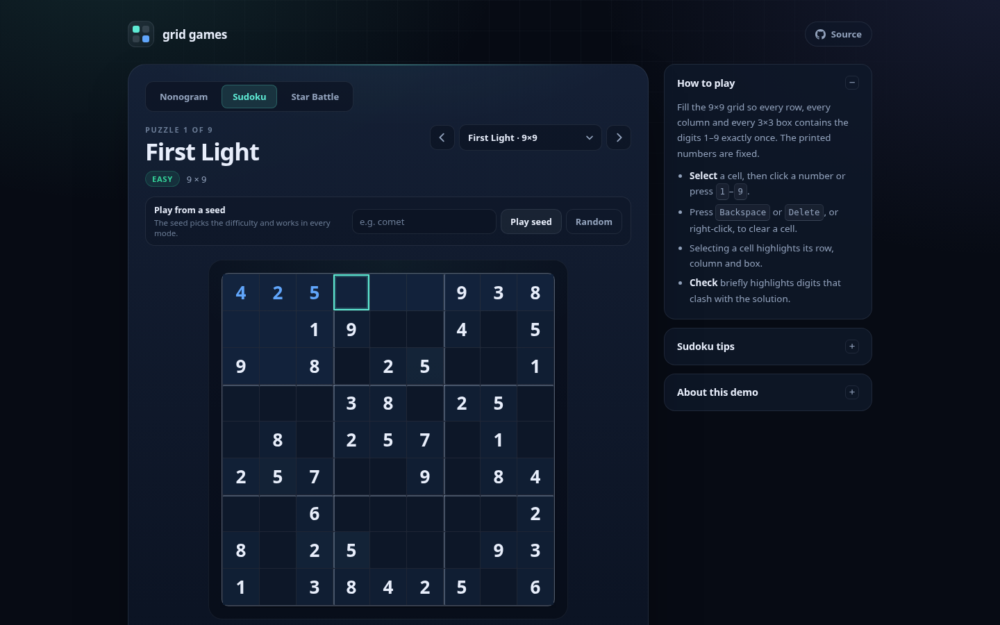
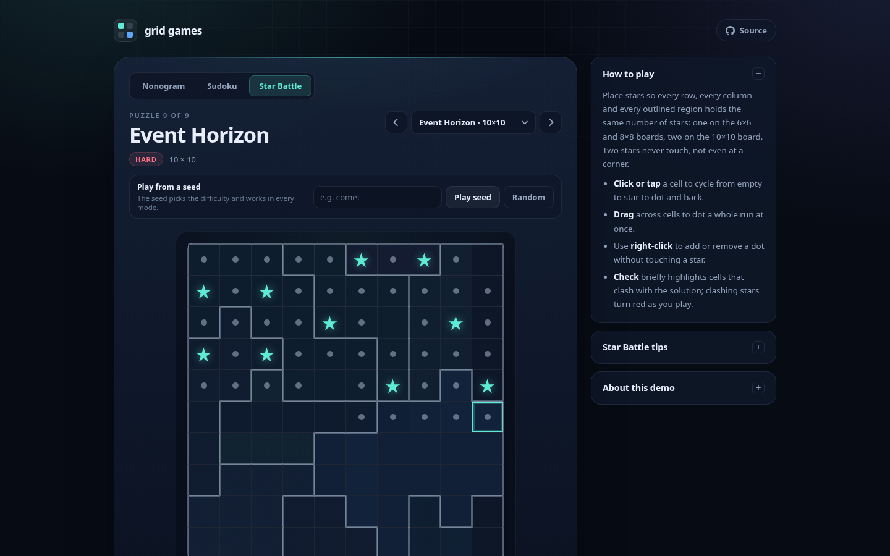
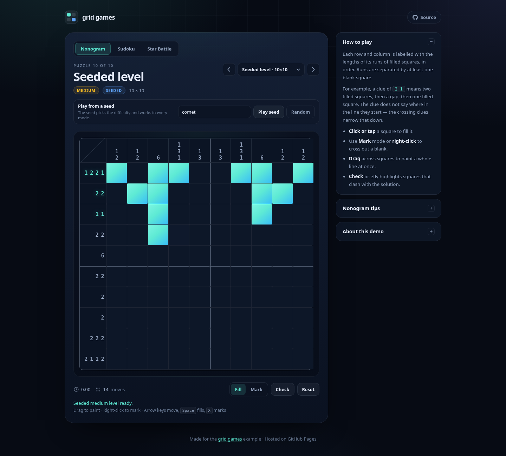

# grid games

A small, dependency-free collection of grid puzzles that runs as a static site on GitHub Pages:

**▶ [Play the games](https://potnoodledev.github.io/nonogram/)**



The site has three modes that share one game shell:

- **Nonogram** — use the number clues to fill squares and reveal a picture.
- **Sudoku** — fill a 9×9 grid so every row, column and 3×3 box contains the digits 1–9 exactly once.
- **Star Battle** — place stars so every row, column and outlined region holds one star (two on the 10×10 boards), with no two stars touching.

All three modes use the same board rendering, timer, move counter, progress persistence, Check helper and win dialog. The rules and presentation for each mode live in a small adapter under `js/modes/`, so another grid variation can reuse the shell without touching the nonogram, Sudoku or Star Battle code.

## Features

- Nine nonogram puzzles from 5×5 to 15×15, nine Sudoku puzzles and nine Star Battle puzzles, grouped into Easy, Medium and Hard.
- Play a level generated from any seed, in every mode: type a seed (or press **Random**) and the same seed gives a matching Easy, Medium or Hard level in nonogram, Sudoku and Star Battle.
- Star Battle boards come in three sizes: 6×6 with one star per line, 8×8 with one, and 10×10 with two.
- Nonogram clues are derived from the art at load time; Sudoku solutions are derived from the givens and Star Battle solutions from the region layouts. Puzzle data cannot drift from its solution.
- Mouse, touch and keyboard input — drag to paint nonogram squares, right-click to mark or erase, type Sudoku digits straight into the grid, and tap a Star Battle cell to cycle through star, dot and empty.
- Completed nonogram rows and columns light up; Sudoku highlights the selected row, column and box and flags duplicate digits; Star Battle outlines its regions, tints their cells and highlights the selected row, column and region.
- An optional **Check** highlights conflicts with the solution, and Star Battle flags clashing stars as you play.
- Progress, timer and move count are saved in `localStorage` per mode, so a reload does not lose your place.
- No build step, no dependencies and no tracking.





## Seeded levels



The puzzle picker keeps the curated levels, and the box above the board adds a level generated from a seed. The seed chooses the difficulty, so the same seed gives a matching level in all three modes:

- **Easy** — a 5×5 nonogram, a Sudoku with about 40 givens, or a 6×6 Star Battle with one star per line.
- **Medium** — a 10×10 nonogram, a Sudoku with about 32 givens, or an 8×8 Star Battle with one star per line.
- **Hard** — a 15×15 nonogram, a Sudoku with about 26 givens, or a 10×10 Star Battle with two stars per line.

Type a seed and press **Play seed** (or **Random** for a fresh one). The generated level goes into the puzzle picker, appears in the URL (for example `#nonogram/seed:comet`), and keeps its progress in `localStorage` like a catalogue puzzle. Switching mode tabs while a seed is active keeps that seed, so the same word can be played in every mode; choosing a curated puzzle leaves seeded mode.

Every generated level has exactly one solution. The nonogram and Sudoku generators build a puzzle and check that solution count while they work; the Star Battle generator starts from a curated layout and makes seeded border moves, keeping only moves that preserve its single solution.

## Run locally

```sh
npm run serve
# or: python3 -m http.server 4173
```

Then open <http://127.0.0.1:4173/>.

## Tests

```sh
npm test
```

This runs the Node suite for the nonogram clue calculation, the Sudoku rules, the Star Battle rules and the seeded generators. It validates that every nonogram's derived clues match its art, that every Sudoku and Star Battle layout has exactly one solution, and that a seed produces the same unique, valid level every time.

The browser smoke test (all modes, layout, input, solving, persistence) needs Playwright and a running local server:

```sh
npm i -D playwright
npx playwright install chromium
npm run serve          # in another terminal
npm run test:e2e
```

Set `BASE_URL` to point the browser test at another server, for example `BASE_URL=https://potnoodledev.github.io/nonogram/ npm run test:e2e`. Set `PLAYWRIGHT_CHROMIUM` to use a specific Chromium binary.

## Project layout

```text
index.html               page shell and the per-mode help panels
css/styles.css           all styling, including the responsive board sizing
js/grid.js               tiny shared helpers (grids, time formatting)
js/game.js               shared game shell: board, input, timer, persistence, dialogs
js/seed.js               seed hashing, normalized ids and the seeded random generator
js/generators.js         seeded nonogram, Sudoku and Star Battle level generators
js/modes/nonogram.js     nonogram rules adapter and clue rendering
js/modes/sudoku.js       sudoku rules adapter, digit pad and highlighting
js/modes/starbattle.js   star battle rules adapter, region rendering and input
js/nonogram.js           pure nonogram rules: clues, completion, mistakes, win check
js/sudoku.js             pure sudoku rules: parsing, conflicts, solving, win check
js/starbattle.js         pure star battle rules: parsing, solving, clashes, win check
js/puzzles.js            nonogram art; clues are derived from the art at load time
js/sudoku-puzzles.js     sudoku givens; solutions are derived from the givens at load time
js/starbattle-puzzles.js star battle region layouts; solutions are derived at load time
js/app.js                boots the shared shell with all three modes
tests/                   Node unit tests and the Playwright smoke test
docs/evidence/           screenshots used in the pull request and this README
```

## Adding a nonogram

Add an entry to `PUZZLE_ART` in `js/puzzles.js` with an `id`, `name`, `difficulty` and rows of `#` (filled) and `.` (blank). The clues are computed from the art, and the puzzle automatically appears in the picker. Keep every row the same width; the unit tests check this and verify the generated clues.

## Adding a Sudoku

Add an entry to `SUDOKU_DEFINITIONS` in `js/sudoku-puzzles.js` with an `id`, `name`, `difficulty` and 81-character `givens` string (`1`–`9` for givens, `.` for blanks). The solution is computed from the givens at load time, and the unit tests verify that the puzzle has exactly one solution.

## Adding a Star Battle

Add an entry to `STAR_BATTLE_DEFINITIONS` in `js/starbattle-puzzles.js` with an `id`, `name`, `difficulty` and a region `code`. The code starts with `<size>/<stars>:` and is followed by one letter per cell, row by row, naming the cell's region (the first region is `a`). For example, `6/1:aaaaaabbbbbb...` describes a 6×6 board with one star per line. Regions must be edge-connected, each must have room for its stars, and the unit tests verify that the layout has exactly one solution.

## Adding another mode

Create an adapter in `js/modes/` that provides the puzzle catalogue, board layout, cell rendering, input hooks and a toolbar. Register it in `js/app.js`; the shell handles the board DOM, focus navigation, timer, moves, persistence, checking and the win dialog. The interface is documented in [`js/modes/README.md`](js/modes/README.md), and `js/modes/nonogram.js`, `js/modes/sudoku.js` and `js/modes/starbattle.js` are complete examples.

## Credits

Star Battle's region layouts are adapted from the Star Battle levels in [RetroStoneVC](https://github.com/potnoodledev/RetroStoneVC), released under the MIT licence, © 2026 Pierre-Louis Boyer (8BCraft). The puzzle selection, names and difficulty grouping are this project's. See [THIRD_PARTY.md](THIRD_PARTY.md) for the full notice.

## Deployment

GitHub Pages publishes the `main` branch root at <https://potnoodledev.github.io/nonogram/>. Pushing to `main` rebuilds the site; `.nojekyll` makes Pages serve the files as-is. The repository is public because GitHub Pages on the current plan requires a public repository.
